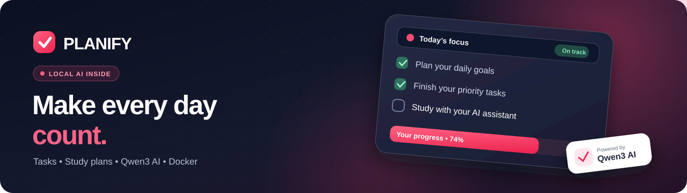
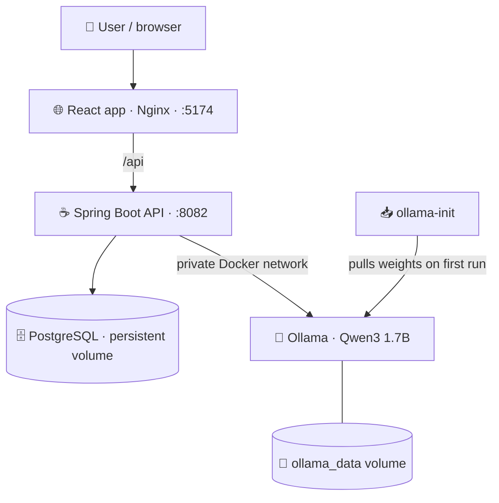

<div align="center">



# ✨ PLANIFY

### Your day, organized. Your learning, accelerated.

**Daily planner · AI study roadmaps · Developer assistant · Private Qwen3 inference**

[](https://github.com/Mohan97babu/AI-TodoApp/actions/workflows/ci.yml?query=branch%3Amothini)
[](https://react.dev/)
[](https://spring.io/projects/spring-boot)
[](https://www.postgresql.org/)
[](https://ollama.com/library/qwen3)
[](https://docs.docker.com/compose/)

**[Get started](#quick-start) · [Features](#features) · [Architecture](#architecture) · [Commands](#commands) · [Troubleshooting](#troubleshooting) · [Roadmap](#roadmap)**

</div>

---

<a id="overview"></a>
## 🌟 About Planify

**Planify** combines an everyday to-do list with a built-in **AI coding and study assistant**. Create tasks, prioritize deadlines, follow your completion progress, build day-by-day study plans and ask programming questions — in one React application.

It runs with a Spring Boot REST API, a PostgreSQL database and a **self-hosted Qwen3 1.7B model** through Ollama. The recommended Docker setup handles all application services together.

> **Important:** The AI model is **automatically downloaded during the first Docker startup**, not included in the Git repository or copied from the original developer’s computer. Other users do **not** need an `E:\model` folder or a separate model installation. Each new computer downloads the model **once**, then reuses its Docker volume. Internet access is needed for that first download.

<a id="features"></a>
## ✨ Features

| Area | What you can do |
|:---|:---|
| ✅ **Daily task management** | Create, edit, complete, delete, search, filter and sort tasks |
| 📊 **Progress dashboard** | Track your task overview, priorities and completion progress |
| 🗓️ **AI study planner** | Generate structured learning plans by topic, level, duration and daily study time |
| 📝 **Plan review** | Review and edit generated study days and task details before scheduling |
| 🤖 **AI developer assistant** | Ask coding questions using a local Qwen3 model served inside Docker |
| 🔗 **Learning references** | Discover suggested references from GeeksforGeeks, W3Schools and TPointTech |
| 📌 **Convert advice to tasks** | Add suggested coding exercises and practice steps to your to-do list |
| 🔐 **Personal accounts** | JWT-based authentication, BCrypt password hashes and user-scoped task data |
| 🎨 **Responsive experience** | Dark/light appearance, focus states, micro-interactions and mobile-oriented navigation |
| 🔔 **Reminders** | Browser notification and sound features, subject to browser permissions and app availability |
| 🐳 **One-command setup** | Docker Compose launches the app, database and model server together |

### 🎨 Planify Minimal interface

The default experience is a calm **light workspace**, with an optional matching dark theme. The four-item navigation opens **Dashboard**, **My Tasks**, **Study Planner**, or **AI Assistant**; it does not advertise unfinished features.

- **Task-first dashboard:** a simple greeting and three real-data metrics (Due today, In progress, Completed), followed by the task list.
- **One primary task action:** choose **New task** or press **N** outside input fields to reveal the task form; it is collapsed at other times.
- **Less visual clutter:** one search field in the top bar, status tabs, a category dropdown, and a separate sort dropdown.
- **AI only when needed:** the assistant opens as a closable drawer, with optional tutorial-link toggles under **Suggested learning links**.
- **Responsive and accessible:** keyboard-focus styling, readable mobile layouts, scrollable code/tables, and modal focus handling.

Previously selected light/dark preference is respected from browser storage. **The UI shows your actual tasks and counts**; example numbers in visual design references are not real app data.

**About learning references:** the application ships with a small **curated local programming knowledge catalog** and suggested tutorial links. The source toggles filter those suggested links; they **do not** scrape or retrieve current content from those sites.

<a id="architecture"></a>
## 🧩 Technology and architecture

| Layer | Technology |
|---|---|
| Frontend | React 18, Vite 5, JavaScript, CSS |
| Frontend hosting | Nginx in the production container |
| API | Java 17, Spring Boot 3.2, Spring Security, Spring Data JPA |
| Database | PostgreSQL 16 in Docker; H2 for optional native development |
| AI model | Qwen3 1.7B, served by Ollama through an OpenAI-compatible endpoint |
| Containers | Docker Compose with persistent PostgreSQL and Ollama volumes |
| Continuous integration | GitHub Actions: frontend tests/build, Maven verification, Compose and API smoke tests |



The browser calls Spring Boot for protected actions; the browser does **not** connect directly to Ollama. The model server does **not** publish port 11434 to the host, and no public Ollama API key is required inside the Compose network.

<a id="quick-start"></a>
## 🚀 Quick start — clone and run everything

**Recommended for all new users:** Docker. No host installation of Qwen, Ollama, Python, Java, Maven, npm or Node.js is required.

**Prerequisites:** Git, a working Docker installation with Docker Compose, internet access for the first image/model download, and enough RAM and free disk space for model inference. **Docker Desktop** is appropriate for Windows/macOS; **Docker Engine + Compose** for Linux.

### 🪟 Windows — PowerShell

Open **PowerShell** in the directory where you want the project:

```powershell
git clone --branch mothini https://github.com/Mohan97babu/AI-TodoApp.git
cd AI-TodoApp
.\start-docker.ps1
```

The startup script creates a private `.env` with a random database password and JWT secret if one does not already exist; then it starts the Docker services and initiates the Qwen download.

**Open the application:** **http://localhost:5174**

If you already cloned the repository, run from your project folder:

```powershell
git switch mothini
git pull --ff-only origin mothini
.\start-docker.ps1
```

### 🐧 Linux / 🍎 macOS — terminal

```bash
git clone --branch mothini https://github.com/Mohan97babu/AI-TodoApp.git
cd AI-TodoApp
sh ./start-docker.sh
```

**Open the application:** **http://localhost:5174**

> **First-run behavior:** Ollama downloads the default `qwen3:1.7b` weights (approximately **1.4 GB**) automatically. The database and AI model are retained in separate Docker volumes. The `backend` waits for the model initialization step; the site may not be available until the download completes. First-run speed depends on your internet connection, disk, CPU and available RAM.

### ✅ Confirm everything started

Open another terminal **inside the cloned project folder**:

```powershell
docker compose ps
docker compose logs --tail 100 ollama-init
docker compose exec ollama ollama list
docker compose logs --tail 100 backend
```

The Ollama model list should include `qwen3:1.7b`. In PowerShell, check the backend health endpoint:

```powershell
curl.exe http://localhost:8082/actuator/health
```

A healthy running backend responds with `{"status":"UP"}`. Model presence confirms the weight download; **actual answer generation should also be checked manually in the AI chat**.

<a id="commands"></a>
## 🖥️ Docker commands cheat sheet

Run these from the **repository root**.

| Goal | Command |
|---|---|
| Build and start everything | `docker compose up --build -d` |
| View running services | `docker compose ps` |
| Follow model download | `docker compose logs -f ollama-init` |
| Check cached models | `docker compose exec ollama ollama list` |
| Follow backend output | `docker compose logs -f backend` |
| Follow Ollama output | `docker compose logs -f ollama` |
| Stop and preserve data | `docker compose down` |
| Restart existing containers | `docker compose up -d` |
| Rebuild after code updates | `docker compose up --build -d` |
| Inspect effective configuration | `docker compose config` |

**Never run `docker compose down -v` unless you deliberately want to delete your stored PostgreSQL data and the cached model weights.** Normal `docker compose down` preserves both volumes.

### 💾 Where the model lives

The default Docker model is Ollama’s **`qwen3:1.7b`** (approximately 1.4 GB, typically its Q4_K_M quantization). It is kept in Docker’s **`ollama_data`** volume, not the project Git folder.

- **First clone on a different computer:** a fresh model download occurs automatically.
- **After restarting Docker:** the existing weights are reused.
- **After a normal image rebuild:** the named volume persists.
- **After deleting volumes or changing the model tag:** a download may be needed again.
- **Existing local GGUF:** the developer’s separate `Qwen3-1.7B-Q6_K.gguf` file is *not* the default Docker model and is not copied into the repository.

To use another Ollama-compatible model tag, set `OLLAMA_MODEL` in your `.env` and start the stack again. A different tag can require more RAM/disk and may not be compatible with every API behavior.

### ⚡ Optional NVIDIA GPU acceleration

The standard Docker Compose configuration runs on CPU without requiring NVIDIA hardware. On supported systems with Docker GPU passthrough, drivers and NVIDIA container support already set up:

```powershell
docker compose -f docker-compose.yml -f docker-compose.gpu.yml up --build -d
```

CPU inference may be significantly slower. GPU passthrough and performance have **not** been verified on all host operating systems and devices.

<a id="usage"></a>
## 📅 How to use Planify

**1. Register and sign in.** Use the application’s authentication flow. User-specific tasks are saved in PostgreSQL in Docker mode.

**2. Plan your day.** Add a task, choose its details, then filter or sort the list. Complete tasks as you finish them and review the dashboard overview.

**3. Generate a study plan.** Open the AI study planner, enter a topic, duration and skill level, then review/edit the proposed schedule before adding its tasks.

**4. Ask your AI assistant.** Open the developer assistant and ask a programming question. When Ollama is running, the backend uses Qwen3; if it cannot reach the model, the assistant may return limited built-in study guidance instead of a model-generated answer.

**5. Use suggested references.** The learning-site toggles control which **suggested links** appear — no live web ingestion or external webpage verification is performed.

*Screenshots: no verified application screenshots are currently committed to this repository. Add real browser screenshots under `assets/` after visual review rather than displaying concept art as a real app screen.*

<a id="configuration"></a>
## ⚙️ Configuration and environment

Both Docker launcher scripts can generate a `.env` automatically. The file is **local and ignored by Git**. If you manually configure the app, copy `.env.example` and replace sensitive placeholders.

| Environment variable | Purpose | Docker behavior |
|---|---|---|
| `DB_NAME` | PostgreSQL database | Default: `tododb` |
| `DB_USER` | PostgreSQL user | Default: `planify` |
| `DB_PASSWORD` | Database password | Required; startup script generates one |
| `JWT_SECRET` | JWT signing key | Required; startup script generates one |
| `OLLAMA_MODEL` | Ollama model tag to pull and serve | Default: `qwen3:1.7b` |
| `CORS_ALLOWED_ORIGINS` | Allowed browser origins | Local frontend URLs by default |
| `OPENAI_API_KEY`, `OPENAI_API_URL`, `OPENAI_MODEL` | Optional standalone Windows model gateway settings | **Ignored by Docker backend**; Compose uses its private Ollama endpoint |

**Security:** Ollama’s internal API has no independent authentication. Keep it on the private Compose network; do not publish port 11434 onto the internet. Never commit `.env`. Any credentials committed in **older Git history must be rotated**, even if absent from the latest version.

<a id="native"></a>
## 🛠️ Optional: Windows development without Docker

<details>
<summary><strong>Expand standalone frontend, backend and model setup</strong></summary>

This is an alternative **developer workflow**. It is **not necessary** for users following Docker Quick Start.

**Requirements:** Java 17+, Maven, Node.js/npm, Python and an independently installed compatible local Qwen gateway. The Windows launcher expects `E:\model\run_server.py` by default (or set `MODEL_HOME` to your gateway folder). Your model and gateway are *not* committed to this repository.

From the repository root, create and edit your local environment:

```powershell
Copy-Item .env.example .env
notepad .env
```

Use a strong `JWT_SECRET`. Set your **standalone** `OPENAI_API_KEY`, `OPENAI_API_URL=http://localhost:8000/v1/chat/completions` and `OPENAI_MODEL=qwen3-1.7b` according to the server you actually run.

**One-command native launcher** (PowerShell, from repository root):

```powershell
.\start.ps1
```

Or from Command Prompt (CMD): `start.bat`.

**Manual launch** — open three separate terminals, each initially in the cloned repository root:

**Terminal 1 — optional Qwen gateway on the owner’s Windows machine:**

```powershell
cd E:\model
python run_server.py --host 127.0.0.1 --port 8000 --no-browser
```

**Terminal 2 — Spring Boot backend (import your `.env` before running):**

```powershell
Get-Content .env | ForEach-Object {
  if ($_ -match '^\s*([A-Za-z_][A-Za-z0-9_]*)\s*=\s*(.*)$') {
    [Environment]::SetEnvironmentVariable($Matches[1], $Matches[2].Trim().Trim('"').Trim("'"), 'Process')
  }
}
$env:OPENAI_API_URL = 'http://localhost:8000/v1/chat/completions'
cd backend
mvn spring-boot:run "-Dspring-boot.run.profiles=h2"
```

**Terminal 3 — React development server:**

```powershell
cd frontend
npm ci
npm run dev
```

The native backend uses **H2 in-memory development storage**. Its tasks do **not** persist after a full backend restart. This mode is not a substitute for PostgreSQL-based deployment. Do not run Docker mode simultaneously on ports 5174 or 8082.

</details>

<a id="tests"></a>
## 🧪 Quality checks and CI

[](https://github.com/Mohan97babu/AI-TodoApp/actions/workflows/ci.yml?query=branch%3Amothini)

GitHub Actions checks frontend tests and production build, backend Maven verification, Docker Compose configuration, credentials-pattern scanning, and integration tests.

| Check | What it tests |
|---|---|
| **Frontend** | JavaScript unit tests and Vite production build |
| **Backend** | Maven/JUnit verification |
| **Compose** | Configuration validity and committed credential patterns |
| **Container smoke** | Health checks, authenticated endpoints, registration/login, task CRUD and cross-user isolation |
| **AI routing** | Authenticated chatbot requests through Spring Boot to an **OpenAI-compatible simulated model server** |

**CI limitation:** the test workflow does **not** download Qwen weights or prove real inference/GPU behavior. The `docker-compose.ci.yml` override replaces Ollama with a small simulator *for CI only*. Normal `docker-compose.yml` downloads and runs **real Qwen3**.

For contributors with Node.js installed:

```powershell
cd frontend
npm ci
npm test
npm run build
```

For contributors with Java 17/Maven installed, from the repository root:

```powershell
cd backend
mvn -B -ntp verify
```

<a id="structure"></a>
## 🗂️ Project structure

```text
AI-TodoApp/
├── assets/
│   └── readme-banner.svg        Original README artwork
├── frontend/
│   ├── src/
│   │   ├── components/          Dashboard, tasks, filters, chat and study planner
│   │   ├── services/            Backend API clients
│   │   └── index.css            Application styles
│   ├── tests/                   Frontend unit tests
│   └── Dockerfile               Vite build + Nginx
├── backend/
│   ├── src/main/java/com/todoapp/
│   │   ├── controller/          REST endpoints
│   │   ├── config/              Authentication, CORS and filters
│   │   ├── entity/              User, task and study plan data
│   │   ├── repository/          Database access
│   │   └── service/             Business logic and AI integrations
│   ├── src/main/resources/
│   └── Dockerfile               Spring Boot API container
├── scripts/
│   ├── smoke_test.py            Auth, task and model-routing integration test
│   └── mock_ollama.py           CI-only model API simulator
├── .github/workflows/ci.yml     Automated checks
├── .env.example                 Environment template (no real secrets)
├── docker-compose.yml           App + PostgreSQL + Ollama model server
├── docker-compose.gpu.yml       Optional NVIDIA GPU overlay
├── docker-compose.ci.yml        Model simulator overlay used by CI
├── start-docker.ps1             Windows Docker bootstrap
├── start-docker.sh              Linux/macOS Docker bootstrap
├── start.ps1                    Optional native Windows launch
└── start.bat                    Optional native CMD launch
```

<a id="troubleshooting"></a>
## 🔧 Troubleshooting

<details>
<summary><strong>Docker is not starting</strong></summary>

Check that Docker Desktop / Docker Engine is running and your ports **5174**, **8082** and **5433** are available. From the repository root:

```powershell
docker compose config
docker compose ps
docker compose logs --tail 100 backend
docker compose logs --tail 100 postgres
docker compose logs --tail 100 frontend
```

If an existing `.env` still contains `CHANGE_ME` for `DB_PASSWORD` or `JWT_SECRET`, edit the file and supply strong values. The startup scripts preserve existing configuration instead of overwriting it.

</details>

<details>
<summary><strong>Qwen shows offline or gives only fallback answers</strong></summary>

```powershell
docker compose logs --tail 150 ollama-init
docker compose logs --tail 150 ollama
docker compose exec ollama ollama list
```

Ensure the model download completed and `qwen3:1.7b` is listed. The API backend connects internally to `ollama:11434`; **port 8000 is only for the optional non-Docker gateway**. CPU inference can be slow, especially with limited RAM.

</details>

<details>
<summary><strong>Changed a database password, but PostgreSQL cannot connect</strong></summary>

Changing `DB_USER` or `DB_PASSWORD` in Compose/`.env` does **not** alter database credentials in an already-initialized PostgreSQL volume. Migrate the credentials inside PostgreSQL and back up the database first. **Do not delete production volumes merely to reset a password.**

</details>

<details>
<summary><strong>Updated code or model tag, but still see an old version</strong></summary>

```powershell
git switch mothini
git pull --ff-only origin mothini
docker compose up --build -d
docker compose ps
```

If you changed `OLLAMA_MODEL`, the model-init service pulls the selected tag. This may require another model download.

</details>

<a id="roadmap"></a>
## 🗺️ Roadmap

- [x] React task dashboard with filters, sorting and responsive navigation
- [x] Authentication and user-scoped task data
- [x] AI study plan generation and editable scheduling
- [x] Qwen3-powered coding assistant with curated tutorial references
- [x] Dockerized Nginx frontend, Spring Boot API and PostgreSQL
- [x] Automated Qwen3 download into a persistent Ollama Docker volume
- [x] Windows and Linux/macOS one-command Docker bootstrap scripts
- [x] Frontend/backend tests and Docker/API integration tests in GitHub Actions
- [ ] Real-model inference and performance acceptance on target CPU/GPU hardware
- [ ] HTTPS, firewall/access policies, monitoring and backup/restore drills for public hosting
- [ ] Production database migration strategy, load tests and rate-limit verification
- [ ] Verified screenshots, accessibility audit and multi-device browser testing
- [ ] Source-attributed, policy-compliant live reference retrieval (optional future enhancement)

<a id="release"></a>
## 🔒 Release readiness and limitations

The Docker stack is intended as a convenient, reproducible **local/self-hosted deployment**, not a claim of production certification. Before making the app public, configure **HTTPS**, network security, backups and recovery, monitoring, safe secret rotation and database migrations. Keep Ollama's API private.

The programming references are **curated local summaries with suggested links**, not live crawls of GeeksforGeeks, W3Schools or TPointTech. AI outputs may be inaccurate and should be reviewed. Browser reminders depend on permissions and browser behavior. CI checks routing using a simulator rather than the real Qwen weights; validate actual performance before claiming GPU or production readiness.

<a id="contributing"></a>
## 🤝 Contributing

Contributions and bug reports are welcome through [GitHub Issues](https://github.com/Mohan97babu/AI-TodoApp/issues). Please include reproduction steps, browser/OS, whether you used Docker or native mode, relevant non-sensitive logs and expected versus actual behavior.

To work on the existing development branch:

```powershell
git clone --branch mothini https://github.com/Mohan97babu/AI-TodoApp.git
cd AI-TodoApp
git status
```

Make changes, run the relevant tests, and submit a pull request. Do not include `.env`, API keys, JWT secrets or private data in commits or issue reports.

---

<div align="center">

**✨ PLANIFY — plan with purpose, learn with momentum.**

Made with React · Spring Boot · PostgreSQL · Docker · Ollama · Qwen3

[Back to top](#-planify)

</div>
